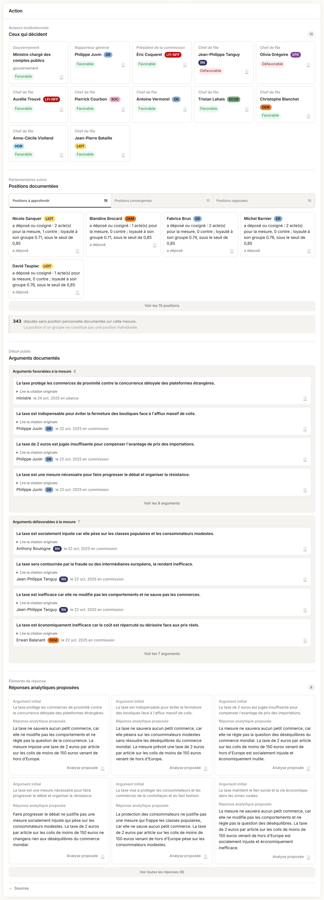
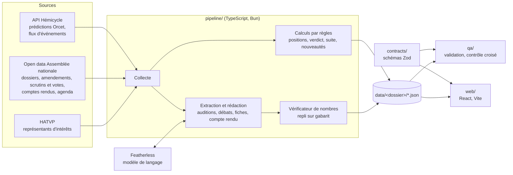

# LegiSpot

**Le tableau de bord parlementaire des cabinets d'affaires publiques : une mesure, un client, des objectifs, et la preuve de chaque analyse.**

LegiSpot transforme les données ouvertes du Parlement en un tableau de bord par dossier. Un dossier, c'est un client, la mesure législative qui le touche et ses objectifs classés par priorité. Le consultant y lit où en est la mesure, ce qui vient de changer, ce qui arrive, sur qui agir et ce qu'il peut écrire à son client. Chaque information renvoie à sa source officielle ou au raisonnement qui l'a produite.

Projet construit le 14 novembre 2026 pendant le Hackathon Open Data (swanbase et Hémicycle, Paris). Nom du produit : LegiSpot. Nom interne dans le code : `bascule`. Nom du dépôt : `Legiscope`.


<!-- VIDEO : insérer ici le lien de la vidéo de démonstration quand elle est prête. -->

## Lire ce dépôt

| Ordre | Document | Pour quoi faire |
|---|---|---|
| 1 | `README.md` (cette page) | Comprendre le produit |
| 2 | [docs/REVIEWER_GUIDE.md](docs/REVIEWER_GUIDE.md) | Retrouver chaque fonctionnalité dans le code, les données et l'interface |
| 3 | [docs/ARCHITECTURE.md](docs/ARCHITECTURE.md) | Comprendre le système et suivre un amendement de la source à l'écran |
| 4 | [docs/DATA_AND_AI.md](docs/DATA_AND_AI.md) | Sources, règles de calcul, rôle exact du modèle de langage et d'Orcet |
| 5 | [docs/REPRODUCE.md](docs/REPRODUCE.md) | Lancer, vérifier, régénérer |
| 6 | [contracts/README.md](contracts/README.md) | Les contrats de données (schémas Zod) |
| 7 | [AGENTS.md](AGENTS.md) | Repères pour un agent de code : structure, commandes, points d'entrée |

Les documents de la journée de construction (plan, consignes des sessions, journaux) sont conservés et listés dans [docs/HISTORIQUE.md](docs/HISTORIQUE.md). Ils peuvent contredire l'état final : la référence est cette page et le dossier `docs/`.

## Le problème

Un cabinet d'affaires publiques suit pour ses clients des mesures précises, pas des lois entières. Une mesure naît dans un article, se modifie par amendement, disparaît en commission, revient en séance. Pour savoir où elle en est, le consultant recoupe à la main les textes, les amendements, les scrutins, les comptes rendus, les auditions et le répertoire des représentants d'intérêts. La collecte ne suffit pas : il faut encore interpréter, puis justifier l'analyse devant le client.

## La solution

L'unité de travail est le **dossier : client + sujet + mesure suivie + objectifs classés** (un objectif principal, puis des objectifs de repli). On suit la mesure par rapport aux objectifs du client, pas seulement le texte de loi.

Chaque dossier se lit en cinq blocs :

| Bloc | Question du cabinet | Ce qu'il lit |
|---|---|---|
| **Verdict** | Est-ce en bonne voie ? | Pour chaque objectif : situation, tendance, confiance, ce qui joue pour, ce qui bloque, et l'événement qui a fait bouger le verdict |
| **Nouveautés** | Que s'est-il passé, et qu'est-ce qui compte ? | Les événements parlementaires qui touchent la mesure, triés par importance, avec leur effet sur le verdict |
| **Suite** | Quelles sont les prochaines dates ? | Les échéances connues, la dernière occasion d'agir, ce qui a le plus de chances de se produire |
| **Action** | Qui décide, et sur qui agir ? | Ceux qui décident, trois groupes de députés (sur qui agir, alliés, perdus), les arguments entendus et des réponses possibles |
| **Compte rendu** | Que puis-je reprendre pour mon client ? | Une synthèse courte dont les chiffres sont contrôlés |

En fond : l'état de la mesure, la base documentaire (articles, amendements), la fiche des députés cités et une page des sources.

LegiSpot est un assistant d'analyse. Il propose une lecture et montre ses preuves. Le consultant reste responsable de son jugement.

## Ce qui est réellement construit

Chaque ligne renvoie au code qui la réalise. Le détail, avec les fichiers de données et les composants d'interface, est dans [docs/REVIEWER_GUIDE.md](docs/REVIEWER_GUIDE.md).

| Capacité | Où dans le code |
|---|---|
| Collecte de plusieurs sources parlementaires | [pipeline/collecte/](pipeline/collecte/) |
| Rattachement des amendements à la mesure suivie | [pipeline/collecte/amendements-opendata.ts](pipeline/collecte/amendements-opendata.ts), [pipeline/pivots/lib/sujet.ts](pipeline/pivots/lib/sujet.ts), [pipeline/amendements/](pipeline/amendements/) |
| Verdict par objectif, calculé par des règles | [pipeline/pivots/verdict.ts](pipeline/pivots/verdict.ts) |
| Positions des groupes et des députés, députés à convaincre | [pipeline/pivots/](pipeline/pivots/), [pipeline/fiches/lib/action.ts](pipeline/fiches/lib/action.ts) |
| Événements datés et leur effet sur le verdict | [pipeline/fiches/lib/nouveautes.ts](pipeline/fiches/lib/nouveautes.ts) |
| Échéances et prédictions Orcet quand elles existent | [pipeline/suite/run.ts](pipeline/suite/run.ts), [pipeline/collecte/api.ts](pipeline/collecte/api.ts) |
| Personnes entendues en audition, extraites des rapports | [pipeline/auditions/](pipeline/auditions/) |
| Interventions en séance et en commission, classées pour ou contre | [pipeline/debats/](pipeline/debats/) |
| Organisations déclarées au répertoire HATVP | [pipeline/collecte/hatvp.ts](pipeline/collecte/hatvp.ts) |
| Compte rendu rédigé par un modèle, nombres contrôlés, repli sur gabarit | [pipeline/note/run.ts](pipeline/note/run.ts), [pipeline/lib/llm.ts](pipeline/lib/llm.ts), [pipeline/lib/verif.ts](pipeline/lib/verif.ts) |
| Preuve sur chaque information : fait, déduction ou inconnue | [contracts/schemas/preuve.ts](contracts/schemas/preuve.ts), [web/src/components/Pourquoi.tsx](web/src/components/Pourquoi.tsx) |
| Contrats de données et validation | [contracts/schemas/](contracts/schemas/), [qa/check.ts](qa/check.ts), [qa/croise.ts](qa/croise.ts) |

## Démonstration

Les dossiers sont déclarés dans [data/config.json](data/config.json). Après `npm run dev`, chacun s'ouvre à l'adresse `http://localhost:5173/dossier/<identifiant>`.

| Identifiant | Client d'exemple | Mesure suivie | Ce que le dossier montre |
|---|---|---|---|
| `petits-colis` | Alibaba France | Taxe de 2 euros par article sur les petits colis (budget 2026, article 22) | Relecture historique : tout est vu au matin du 19 novembre 2025, rien de postérieur n'est utilisé |
| `plf2027-holdings` | Afep | Taxe sur les holdings et la fortune improductive (budget 2027) | Dossier en cours, 21 scrutins nominatifs liés à la mesure |
| `plf2027-apprentissage` | U2P | Baisse des crédits de l'apprentissage et des aides à l'embauche (budget 2027) | Dossier en cours avec prédictions Orcet sur des amendements en attente, visibles dans le bloc Suite |
| `plf2027-agriculture` | FNSEA | Baisse des crédits des filières agricoles (budget 2027) | Dossier ajouté en fin de journée, traitement rapide |
| `plf2027-logement` | Union sociale pour l'habitat | APL et aides à la pierre (budget 2027) | Dossier ajouté en fin de journée, traitement rapide |
| `plf2027-renovation` | CAPEB | MaPrimeRénov' (budget 2027) | Dossier ajouté en fin de journée, traitement rapide |

Les trois premiers dossiers sont les plus complets. Les trois derniers ont été ajoutés en fin de journée pour montrer que la chaîne s'applique à un nouveau sujet par une entrée de configuration : une partie de leurs analyses repose sur des règles de mots et des gabarits plutôt que sur le modèle de langage, et certains blocs peuvent manquer. Les limites de chaque fichier sont écrites dans son bloc `meta.limits`.

**Les organisations affichées comme clients sont des exemples choisis pour la démonstration.** Aucune n'est cliente du projet ni associée à lui.

Autres vues :

| Adresse | Page |
|---|---|
| `/dossier/:id` | Tableau de bord du dossier |
| `/dossier/:id/base` | Base documentaire : état de la mesure, articles, amendements |
| `/dossier/:id/depute/:pa` | Fiche d'un député sur ce dossier |
| `/sources` | Sources institutionnelles utilisées |

| Verdict | Action |
|---|---|
|  |  |

## Architecture

Pas de serveur applicatif. Le pipeline prépare des fichiers JSON, l'interface les lit. Les données de démonstration sont conservées dans le dépôt : ce qui est affiché est reproductible à partir de `data/`. Ce n'est pas une application en temps réel : les données sont celles de la dernière exécution du pipeline.



- **L'open data de l'Assemblée nationale** fournit l'essentiel : dossiers, amendements, scrutins et votes nominatifs, comptes rendus.
- **L'API Hémicycle** fournit les prédictions du modèle Orcet et, en option, un flux d'événements parlementaires, voir [pipeline/collecte/api.ts](pipeline/collecte/api.ts) et [pipeline/fiches/lib/evenements-api.ts](pipeline/fiches/lib/evenements-api.ts).
- **Orcet** donne, pour un amendement en attente, la moyenne des probabilités individuelles de voter pour. Ce n'est pas une probabilité d'adoption. Sans prédiction, rien n'est affiché.
- **Featherless** donne accès au modèle de langage (`Qwen/Qwen3.8-27B` par défaut, voir [pipeline/lib/llm.ts](pipeline/lib/llm.ts)). Il extrait les personnes entendues dans les rapports, classe les interventions des débats et la nature de certains amendements, et rédige des textes à partir de chiffres déjà calculés. Il ne voit aucun vote et ne calcule aucun chiffre.
- **Le verdict et le classement des députés sont calculés par des règles**, pas par le modèle. Le score du verdict est un indicateur descriptif construit par le projet, pas une prédiction validée statistiquement.

Détail dans [docs/ARCHITECTURE.md](docs/ARCHITECTURE.md) et [docs/DATA_AND_AI.md](docs/DATA_AND_AI.md).

| Dossier | Rôle |
|---|---|
| [pipeline/](pipeline/) | Collecte, calculs, extraction et rédaction. Produit `data/` |
| [contracts/](contracts/) | Un schéma Zod par fichier JSON, types, jeu d'exemple |
| [data/](data/) | Les fichiers JSON produits, par dossier |
| [web/](web/) | L'interface (React, Vite, React Router, Recharts) |
| [qa/](qa/) | Validation des schémas, contrôle croisé, vérificateur de nombres, tests |
| [docs/](docs/) | Documentation de la version finale et captures |

## Lancer le projet

Voir l'interface, sans aucune clé :

```sh
git clone https://github.com/aaxxeell09/Legiscope.git
cd Legiscope
npm install
npm run dev
```

Puis ouvrir http://localhost:5173. Les données de démonstration sont déjà dans `data/`.

Régénérer les données demande [Bun](https://bun.sh) et deux clés (`HEMICYCLE_API_KEY`, `FEATHERLESS_API_KEY`) dans un fichier `.env` créé à partir de `.env.example`. La marche à suivre et l'ordre des étapes sont dans [docs/REPRODUCE.md](docs/REPRODUCE.md).

## Vérifications

| Commande | Ce qu'elle vérifie |
|---|---|
| `npm run typecheck` | Les types TypeScript de tout le dépôt |
| `npm run build` | La construction du site statique dans `dist/` |
| `bun run check` | Chaque fichier de `data/` et du jeu d'exemple contre son schéma Zod, et les contrôles croisés entre fichiers |
| `bun test` | Les tests du vérificateur de nombres et de l'appel au modèle |

Les résultats obtenus sur une copie fraîche du dépôt sont consignés dans [docs/REPRODUCE.md](docs/REPRODUCE.md).

## Sources de données

| Source | Ce qu'on en tire | Licence ou conditions |
|---|---|---|
| [Open data de l'Assemblée nationale](https://data.assemblee-nationale.fr) | Députés et groupes, dossiers législatifs, amendements, scrutins et votes nominatifs, comptes rendus de séance, agenda. Les rapports et les comptes rendus de commission sont lus sur [assemblee-nationale.fr](https://www.assemblee-nationale.fr) | [Licence Ouverte](https://data.assemblee-nationale.fr/licence-ouverte-open-licence) (Etalab) |
| [HATVP](https://www.hatvp.fr), [répertoire des représentants d'intérêts](https://www.data.gouv.fr/datasets/repertoire-des-representants-dinterets) | Organisations ayant déclaré une action de représentation d'intérêts sur le sujet | Licence Ouverte (Etalab) |
| [API Hémicycle](https://hemicycle.ai/api) | Prédictions Orcet sur les amendements en attente, flux d'événements parlementaires en option. Deux agrégats (accord entre groupes, loyauté des députés) sont collectés mais ne sont pas encore exploités | Service à clé, conditions d'utilisation d'Hémicycle |
| [Featherless](https://featherless.ai) | Accès à un modèle de langage ouvert, pour l'extraction et la rédaction | Service à clé |

## Limites

- **L'outil propose, le cabinet décide.** Le verdict est une proposition avec ses raisons. Il peut dire qu'il n'y a pas assez d'information pour conclure.
- **Le score du verdict est une règle du projet** (part pondérée des sièges favorables à l'objectif), pas une prédiction validée.
- **Une prédiction Orcet n'est pas une probabilité d'adoption.**
- **La validation automatique contrôle la forme et la cohérence des nombres, pas l'exactitude des conclusions.**
- **La mesure est déclarée à la main** dans `data/config.json` et suivie par ses mots-clés et son article. Le filtre peut retenir un amendement à tort. Sur le dossier `plf2027-holdings`, le rapprochement entre plusieurs propositions fiscales voisines n'est pas entièrement validé.
- **Relecture historique.** Sur `petits-colis`, un sort d'amendement sans date publiée n'est pas listé comme événement daté.
- **L'Assemblée n'est pas l'issue finale.** Les votes et les débats du Sénat ne sont pas analysés.
- **Un député n'est classé que sur ce qu'il a lui-même dit, déposé ou voté.** Quand sa position n'est pas connue, c'est écrit.
- **Auditions et débats : couverture partielle.** Tous les rapports n'ont pas de liste de personnes entendues. Seules les interventions dont l'orateur est identifié sont gardées.
- **HATVP.** Les données sont déclaratives. Le filtre par mots-clés peut retenir une organisation à tort.
- **Hors périmètre.** Vue sur plusieurs dossiers à la fois, presse, alertes, mise en ligne.
- **Projet de hackathon**, construit en une journée. Il n'a pas été audité.

## Équipe et crédits

**Axel** : cadrage du produit à partir du besoin du cabinet ([rendu-final.md](rendu-final.md)), documentation, préparation de la démonstration, consignes de rédaction du modèle.
**Ilan** : plan de construction, contrats de données, pilotage des sessions de développement du pipeline et de l'interface.

Le code a été écrit en une journée avec des sessions Claude Code menées en parallèle sur trois ordinateurs. Leurs consignes et leurs journaux sont conservés (voir [docs/HISTORIQUE.md](docs/HISTORIQUE.md)).

- [Hémicycle](https://hemicycle.ai) : API parlementaire et modèle Orcet. Organisateur du hackathon avec swanbase.
- [Featherless](https://featherless.ai) : accès aux modèles de langage ouverts.
- [Assemblée nationale](https://data.assemblee-nationale.fr) : données ouvertes de la 17e législature.
- [Haute Autorité pour la transparence de la vie publique](https://www.hatvp.fr) : répertoire des représentants d'intérêts.
