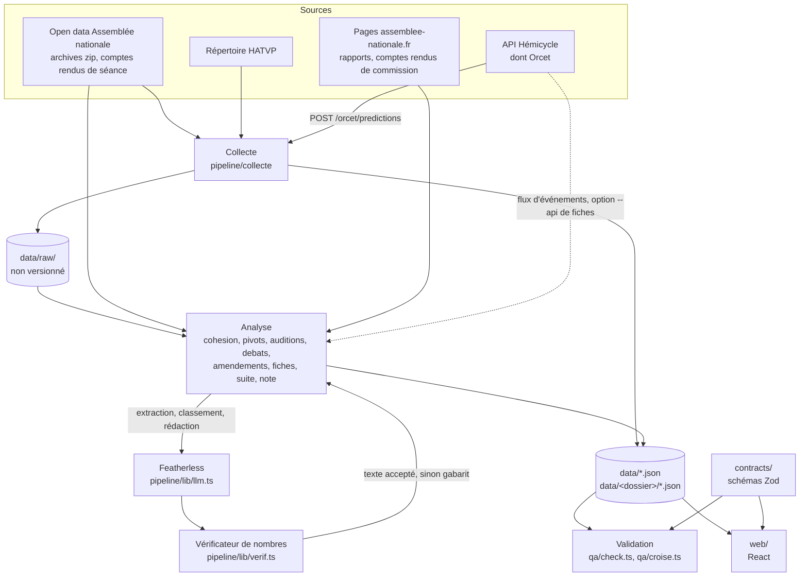
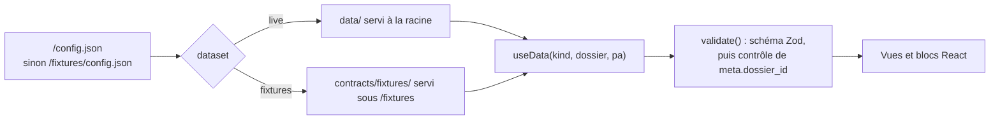

# Architecture de LegiSpot

LegiSpot est un tableau de bord pour cabinets d'affaires publiques : un tableau par dossier (client, sujet, mesure suivie, objectifs hiérarchisés), lu en cinq blocs (Verdict, Nouveautés, Suite, Action, Compte rendu). Le nom interne du code est « Bascule » (`package.json`, `data/config.json`) et le dépôt s'appelle « Legiscope ». Projet construit le 14 novembre 2026 au Hackathon Open Data (swanbase et Hémicycle, Paris).

Ce document décrit le code et les données tels qu'ils ont été lus le 14 novembre 2026 vers 17 h. Chaque chemin cité existe dans le dépôt. Les organisations clientes affichées (Alibaba France, Afep, U2P, FNSEA, Union sociale pour l'habitat, CAPEB) sont illustratives : aucune n'est cliente du projet.

Principe : pas de serveur applicatif. Des scripts produisent des fichiers JSON, des schémas Zod les décrivent, un site statique les lit.

## 1. Structure du dépôt

| Dossier ou fichier | Rôle |
|---|---|
| `pipeline/` | Scripts TypeScript lancés avec Bun, un sous-dossier par étape. `pipeline/lib/` contient le client Featherless (`llm.ts`) et le vérificateur de nombres (`verif.ts`) |
| `data/` | Sortie du pipeline, lue par le front : `config.json`, `groupes.json`, `deputes.json`, `cohesion.json`, puis un sous-dossier par dossier. `data/raw/` (archives et réponses brutes) est exclu par `.gitignore` |
| `contracts/` | Schémas Zod (`contracts/schemas/*.ts`, 21 fichiers), point d'entrée `contracts/index.ts` (map `SCHEMAS`, fonction `dataPath`), jeu d'exemple `contracts/fixtures/` produit par `contracts/generer-fixtures.ts` |
| `web/` | Front : Vite, React, react-router, Recharts. Configuration dans `vite.config.ts` à la racine |
| `qa/` | Validation : `check.ts`, `croise.ts`, `verif.ts`, `verif.test.ts` |
| `prompts/`, `status/`, `demo/` | Consignes des sessions de construction, journaux d'avancement, supports de démonstration |
| `.interface-design/` | Notes de conception de l'interface (`system.md`) |
| `dist/` | Sortie de `bun run build`, exclue par `.gitignore` |
| `.env.example` | Deux clés : `HEMICYCLE_API_KEY`, `FEATHERLESS_API_KEY`. Elles ne servent qu'à régénérer les données |

`data/config.json` déclare six dossiers : `petits-colis` (état `clos`, `date_reference` 2025-11-19, dossier de démonstration), `plf2027-holdings`, `plf2027-apprentissage`, `plf2027-agriculture`, `plf2027-logement`, `plf2027-renovation`. Chaque entrée porte `client`, `mesure`, `objectifs` (rangs 1 à 3), `sujet.mots_cles`, `texte_id`.

## 2. Flux de données

Place d'Orcet. Orcet n'est appelé que dans `pipeline/collecte/api.ts` (et dans le script de test `pipeline/collecte/orcet-test.ts`) : un `POST /orcet/predictions` par amendement en attente, avec un plafond par dossier (`ORCET_MAX`, 25 par défaut). La réponse est écrite dans `data/raw/<dossier>/orcet/<id>.json`. Elle est relue par `pipeline/pivots/definitif.ts` (`predictionOrcet`, qui recopie `moyenne_probabilites_pour` dans `texte.json`, clé `amendements[].prediction.proba_pour`) et par `pipeline/pivots/verdict.ts` (`orcetMoyen`). `pipeline/suite/run.ts` reprend ensuite la valeur depuis `texte.json` (`probables[].proba`). Cette valeur est la moyenne des probabilités individuelles de voter pour un amendement. Ce n'est jamais une probabilité d'adoption d'une loi.

Place de Featherless. `pipeline/lib/llm.ts` est un client compatible OpenAI (paquet `openai`, adresse `https://api.featherless.ai/v1`), modèle `Qwen/Qwen3.8-27B` par défaut (variable `FEATHERLESS_MODEL`). Il est appelé par les étapes d'analyse, jamais par le front. Le front ne fait que deux types de requêtes : `config.json` et les fichiers de données (`web/src/lib/config.tsx`, `web/src/lib/data.ts`).

## 3. Étapes du pipeline

Une étape par sous-dossier de `pipeline/`, lancée par le script du même nom dans `package.json` (`bun run <étape>`, soit `bun pipeline/<étape>/run.ts`). `<d>` désigne `data/<dossier>`.

| Étape | Lit | Écrit | Modèle de langage |
|---|---|---|---|
| `collecte` | Cinq archives open data de l'Assemblée (AMO10, Agenda, Scrutins, Dossiers_Legislatifs, Amendements), répertoire HATVP, API Hémicycle si la clé est présente | `data/groupes.json`, `data/deputes.json`, `<d>/hatvp.json` ; sous `data/raw/` : `opendata/`, `scrutins/`, `<dossier>/amendements.json`, `<dossier>/texte.json`, `<dossier>/scrutins-lies.json`, `<dossier>/orcet/` | Non |
| `cohesion` | Archive des scrutins, `data/config.json`, `data/groupes.json` | `data/cohesion.json` | Non |
| `pivots` | `config.json`, `groupes.json`, `deputes.json`, archives des scrutins et des amendements, `data/raw/<dossier>/texte.json`, `data/raw/<dossier>/orcet/` ; s'ils existent, `<d>/arguments.json` et `<d>/nouveautes.json` | `<d>/pivots.json`, `<d>/texte.json`, `<d>/etat.json`, `<d>/groupes-action.json`, `<d>/verdict.json` | Oui, deux usages : nature d'un amendement quand aucune règle ne tranche (`lib/nature.ts`), phrase de lecture du verdict (`verdict.ts`). Tous les chiffres sont calculés |
| `auditions` | Liste des députés (`groupes-action.json`, `pivots.json`), archive des dossiers législatifs, pages HTML des rapports | `<d>/auditions/<PA>.json` | Oui : extraction des organisations entendues (`lib/organisations.ts`). Sans modèle, lecture heuristique des mêmes lignes |
| `debats` | Liste des députés, archive des comptes rendus de séance (`syseron.xml.zip`), pages des comptes rendus de la commission des finances | `<d>/debats/<PA>.json`, `<d>/arguments.json` | Oui : classement pour ou contre la mesure (`classer.ts`). Option `--sans-classement` : règles seules |
| `amendements` | `data/raw/<dossier>/amendements.json` s'il existe, sinon `pipeline/amendements/cache/<dossier>.json` | `<d>/amendements/<PA>.json` | Non |
| `fiches` | `texte`, `pivots`, `etat`, `hatvp`, `groupes-action`, `arguments`, et les dossiers `auditions/`, `debats/`, `amendements/` | `<d>/fiches/<PA>.json`, `<d>/fiches/index.json`, `<d>/nouveautes.json`, `<d>/action.json` | Oui : synthèse de chaque fiche et contre-arguments (`lib/redaction.ts`). Option `--gabarit` : aucun appel |
| `suite` | `data/cohesion.json`, `<d>/texte.json`, `<d>/etat.json`, archives des dossiers législatifs et de l'agenda | `<d>/suite.json` | Non |
| `note` | `<d>/verdict.json`, `suite.json`, `texte.json`, `nouveautes.json`, `etat.json`, chacun validé par son schéma | `<d>/note.json` | Oui : rédaction du compte rendu, puis garde-fous propres à la note (deux relances au plus, sinon gabarit) |

Précisions vérifiées dans le code :

- `pipeline/collecte/run.ts` enchaîne `groupes-deputes.ts`, `scrutins-opendata.ts`, `amendements-opendata.ts`, `dossiers-opendata.ts`, `hatvp.ts`, `api.ts`. `api.ts` s'arrête sans erreur si `HEMICYCLE_API_KEY` est vide. `lib/hemicycle.ts` compte les crédits et arrête la collecte sous un plancher de 150.
- `api.ts` collecte aussi les agrégats `accord-groupes` et `loyaute-deputes` dans `data/raw/`. Aucun autre script de `pipeline/` ne les relit : la cohésion et la loyauté sont recalculées à partir des scrutins de l'open data.
- Le script `verdict` de `package.json` lance le même fichier que `pivots`. `pipeline/verdict/` et `pipeline/action/` ne contiennent que des consignes et des gabarits (`prompts/*.md`).
- Aucun script n'enchaîne toutes les étapes. L'ordre découle des lectures ci-dessus, avec deux retours : `pivots` relit `arguments.json` (produit par `debats`) et `nouveautes.json` (produit par `fiches`). Le relancer après ces deux étapes complète le classement des députés et la cause du changement du verdict.
- Dossier rejoué : quand `date_reference` est posée, `coupure()` (`pipeline/pivots/lib/sujet.ts`) garde les dépôts datés au plus tard ce jour-là, et les sorts, scrutins et séances datés strictement avant.
- Plusieurs étapes se replient sur `contracts/fixtures/config.json` quand `data/config.json` manque.

## 4. Calcul déterministe et modèle de langage

Ce qui est calculé par des règles, sans modèle :

- Verdict (`pipeline/pivots/verdict.ts`). Score : part des sièges des groupes de position connue qui vont dans le sens de l'objectif, un groupe divisé ou abstentionniste comptant pour moitié. Quand des amendements en attente qui portent la position du client ont une prédiction, le score est corrigé à 30 % par leur moyenne Orcet. Seuils : favorable à partir de 0,55, défavorable sous 0,40, « insuffisant » sous trois groupes de position connue. Tendance : même calcul sept jours plus tôt, écart de plus de 0,03.
- Pivots (`pipeline/pivots/pivots.ts`). Loyauté de chaque député sur douze mois, puis score d'imprévisibilité : 1 moins la loyauté, ou, quand au moins trois scrutins liés au sujet ont un sens lisible, moitié part des votes contraires au groupe sur le sujet et moitié 1 moins la loyauté. Au moins 30 votes exprimés, 4 députés au plus par groupe, 15 au plus par dossier.
- Classement des députés (`construireGroupesAction`, `pipeline/pivots/definitif.ts`). Actionnables, alliés, perdus ou position inconnue, à partir des actes propres de chaque député : `vote`, `depose`, `dit`. Un député sans acte sur la mesure va dans `position_inconnue`. Seul le fondement `dit` dépend d'un classement fait par le modèle (étape `debats`).
- Sens d'un amendement sur la mesure (`pipeline/pivots/lib/sujet.ts`), positions des groupes, cohésion entre groupes, échéances : règles et comptages.

Ce qui est confié au modèle :

- Extraction : liste des organisations entendues dans les annexes des rapports (`pipeline/auditions/lib/organisations.ts`).
- Classement : interventions pour ou contre la mesure (`pipeline/debats/classer.ts`), nature d'un amendement non tranchée par règle (`pipeline/pivots/lib/nature.ts`). Dans les deux cas le modèle doit rendre une citation, et le résultat est rejeté si la citation n'est pas retrouvée dans le texte source. Le champ `nature_mode` de `texte.json` vaut `regle`, `llm` ou `defaut`.
- Rédaction : lecture du verdict, synthèse des fiches, contre-arguments, compte rendu.

Vérificateur de nombres. `pipeline/lib/verif.ts` (réexporté tel quel par `qa/verif.ts`) normalise le texte, extrait les nombres en chiffres et en lettres, étend la liste autorisée (une probabilité 0,71 autorise 71 %, une date ISO autorise son jour, son mois et son année, les années 2024 à 2027 sont toujours admises), puis rejette tout nombre absent de cette liste.

Repli sur gabarit. `redigerVerifie` (`pipeline/lib/llm.ts`) fait jusqu'à trois tentatives. Chaque sortie passe le vérificateur, et une sortie fautive est renvoyée au modèle avec la liste des nombres à retirer. Après trois échecs, ou sans clé, ou si le service ne répond pas, la fonction rend le gabarit rempli par l'appelant, avec `mode: "gabarit"` et `modele: null`. Elle ne lève pas d'exception. Les gabarits sont dans `pipeline/verdict/prompts/gabarit-lecture.md`, `pipeline/fiches/prompts/gabarit-synthese.md`, `pipeline/action/prompts/gabarit-contre-argument.md` et `pipeline/note/prompts/gabarit-note.md`. Chaque texte rédigé est stocké avec `mode`, `modele`, `verifie` et `chiffres_utilises`.

## 5. Contrats Zod

- Emplacement : un schéma par type de fichier dans `contracts/schemas/`, exportés par `contracts/index.ts` avec les types inférés, la map `SCHEMAS` (nom logique vers schéma) et `dataPath(dossierId, kind, pa?, root?)`.
- Usage côté pipeline : plusieurs étapes valident ce qu'elles écrivent (`note` avec `NoteSchema`, `fiches` qui relit chaque fichier écrit, `suite`, `cohesion`).
- Usage côté front : `vite.config.ts` déclare le module virtuel `virtual:contracts` (plugin `contractsPlugin`). Si `contracts/index.ts` existe, le module le réexporte et pose `CONTRACTS_PRESENT = true`. Sinon il n'exporte que `CONTRACTS_PRESENT = false`. `web/src/lib/contracts.ts` y cherche le schéma d'un type (`<Kind>Schema` ou `SCHEMAS[kind]`) et refuse toute donnée sans schéma. Les types sont importés par l'alias `@contracts/index`.
- Bloc `meta` (`contracts/schemas/meta.ts`), présent dans chaque fichier : `generated_at`, `sources` (liste de `label` et `url`), `limits`, `producer`, `dossier_id` (null pour les fichiers de la racine).
- Bloc `preuve` (`contracts/schemas/preuve.ts`), porté par chaque élément affiché : `sources` (au moins une), `raisonnement`, `nature`. La nature vaut `fait` (publié), `deduction` (lecture de l'outil) ou `inconnue`. Le composant `web/src/components/Pourquoi.tsx` l'affiche.
- Règles portées par les schémas : dates ISO, probabilités entre 0 et 1, `accord` null si et seulement si `n_scrutins` vaut 0 (`cohesion.ts`), un seul objectif et un seul verdict de rang 1 (`config.ts`, `verdict.ts`). La règle « `mode: "gabarit"` implique `modele: null` » est contrôlée par `qa/check.ts`, pas par un schéma.

## 6. Chargement côté React

Fichiers de `web/src/lib/` :

- `config.tsx` : `loadConfig()` lit `/config.json` une fois. En cas d'échec il lit `/fixtures/config.json` et force `dataset: "fixtures"`. `baseFor(dataset)` rend le préfixe des URL (vide ou `/fixtures`). `ConfigProvider`, `useConfig()` et `useDossier()` exposent la configuration et le dossier de la route.
- `data.ts` : `useData<T>(kind, dossier?, pa?)` construit le chemin (`pathFor`), télécharge, valide avec le schéma, refuse un fichier dont `meta.dossier_id` diffère du dossier demandé, garde un cache par URL. États rendus : `loading`, `ok`, `error`.
- `contracts.ts` : pont vers `virtual:contracts` (voir section 5).
- `format.ts` : mise en forme des probabilités, dates, noms et nombres.
- `meta-exemple.ts` : objet `meta` d'exemple, qu'aucun autre fichier de `web/src` n'importe.

Service des fichiers (`vite.config.ts`) : `publicDir` pointe sur `data/`, servi à la racine. Le plugin `fixturesPlugin` sert `contracts/fixtures/` sous `/fixtures/` et répond 404 en JSON pour un fichier absent. Au build, il copie les fixtures dans `dist/fixtures/` et `data/` (sans `data/raw/`) dans `dist/`.

Routes de `web/src/App.tsx` :

| Route | Vue | Fichiers chargés par `useData` |
|---|---|---|
| `/` | redirection vers `/dossier/<dossier_demo>` | aucun |
| `/dossier/:id` | `web/src/views/dossier/index.tsx` et les cinq blocs de `web/src/views/blocs/` | `etat`, `verdict`, `nouveautes`, `suite`, `action`, `fiches/index`, `note` ; `cohesion` et `groupes` pour la courbe |
| `/dossier/:id/depute/:pa` | `web/src/views/depute/index.tsx` | `fiches/index`, `action`, `fiches/<pa>`, `deputes`, `groupes` |
| `/dossier/:id/base` | `web/src/views/base/index.tsx` | `etat`, `texte`, `groupes`, `deputes` |
| `/sources` | `web/src/views/sources/index.tsx` | aucun : liste fixe de quatre liens officiels |

Le repli sur `contracts/fixtures/` se décide une fois, au niveau de `config.json`. En mode `live`, un fichier absent ou invalide donne un message d'erreur dans le bloc concerné (`web/src/components/Etat.tsx`), et chaque bloc est isolé par un `ErrorBoundary`. Recharts n'est utilisé que dans `web/src/views/blocs/verdict/Tendance.tsx`. La barre du haut affiche `config.produit.nom`, « LegiSpot » à défaut (`web/src/components/TopBar.tsx`).

## 7. Contrôles

- `qa/check.ts` (`bun run check`) : valide chaque fichier contre son schéma, puis l'intégrité croisée. Sans option il contrôle `data/` et `contracts/fixtures/`. Il vérifie que `meta.dossier_id` égale le dossier du chemin, que tout `groupe_id` existe dans `groupes.json` et tout identifiant de député dans `deputes.json`, que les sous-dossiers présents sont ceux de `config.dossiers`, que chaque pivot a ses fichiers `auditions`, `debats`, `amendements` et une fiche (sauf s'il est listé dans `absents`), que la fiche reprend à l'identique ces trois fichiers et `hatvp.json`, que `note.client` et `note.objectifs` égalent la configuration, qu'il y a un verdict par objectif et que `cause_du_changement.evenement_id` existe dans `nouveautes.json`. Avec une `date_reference` : aucun événement, sort, scrutin ou intervention postérieur, aucune échéance déjà passée. Il repasse enfin le vérificateur sur chaque texte rédigé contre son champ `chiffres_utilises`. Sortie : une ligne `fichier | champ | valeur | message` par erreur, code 1 s'il y en a.
- `qa/croise.ts` (appelé par `check.ts`) : un même fait a la même valeur partout. Sort et nature d'un amendement (référence `texte.json`), groupe d'un député (référence `deputes.json`), aucun député sans fondement hors de `position_inconnue`, situation et score de l'objectif principal repris dans le texte de la note (référence `verdict.json`), cohérence de `etat.json`.
- `qa/verif.ts` : réexport de `pipeline/lib/verif.ts`, pour que le pipeline et le contrôle utilisent le même vérificateur.
- Tests : `qa/verif.test.ts` (10 tests du vérificateur, lancés par `bun run test`) et `pipeline/lib/llm.test.ts` (9 tests de `redigerVerifie` et `appelStructure`, lancés par `bun test pipeline/lib`). `bun run typecheck` lance `tsc --noEmit`.

Relevé du 14 novembre 2026 vers 17 h, sur cette copie : les deux jeux de tests passent, `tsc --noEmit` sort sans erreur, `bun qa/check.ts --root contracts/fixtures` valide 72 fichiers. `bun qa/check.ts --root data` signale 56 erreurs, aucune sur `petits-colis` ni `plf2027-holdings`. Elles portent sur `plf2027-logement` et `plf2027-renovation` (pas encore de `action.json`, `nouveautes.json` ni `fiches/`), et sur le score absent du texte de trois notes.

## 8. Exemple de bout en bout : l'amendement n° 4086 du Gouvernement (dossier `petits-colis`)

1. Source. Open data de l'Assemblée nationale, archive `Amendements.json.zip`, identifiant `AMANR5L17PO838901B1906P1D1N004086`, sur le texte `PRJLANR5L17B1906` (PLF 2026). Page publique : `https://www.assemblee-nationale.fr/dyn/17/amendements/AMANR5L17PO838901B1906P1D1N004086`.
2. Collecte. `pipeline/collecte/run.ts` télécharge l'archive dans `data/raw/opendata/`. `pipeline/collecte/amendements-opendata.ts` garde les amendements qui citent un mot-clé du sujet ou qui portent sur l'article de la mesure (article 22 dans `data/config.json`) et écrit `data/raw/petits-colis/amendements.json`. Limite : `data/raw/` n'est pas versionné, cette sortie n'a pas pu être relue ici. La trace versionnée de la même source est `pipeline/amendements/cache/petits-colis.json`, où l'entrée porte `numero: "I-4086"`, `auteur_type: "Gouvernement"`, `article: "22"`, `date_depot: "2025-11-19"`, `date_sort: "2025-11-19"`, `sort_brut: "Adopté"`, `sujet_par: "article"`.
3. Structure normalisée. `chargerAmendements` (`pipeline/pivots/lib/opendata.ts`) produit le type `AmdtC` (`id`, `numero`, `typeAuteur`, `article`, `dispositif`, `expose`, `dateDepot`, `dateSort`, `sort`). `amendementsDuSujet` (`pipeline/pivots/lib/sujet.ts`) y ajoute `sens`, `sens_raison`, `sur_mesure`, `pertinent`.
4. Analyse. `construireTexte` (`pipeline/pivots/definitif.ts`) traduit `typeAuteur: "Gouvernement"` en `auteur_type: "gouvernement"` et `auteur_id: "GOUVERNEMENT"`. `sortUnifie` applique la règle du dossier rejoué : le sort est daté du 19 novembre 2025, jour de la `date_reference`, donc il n'est pas encore connu ce matin-là et l'amendement reste `en_attente`, bien que la source le donne adopté.
5. Fichiers JSON où il apparaît :
   - `data/petits-colis/texte.json`, tableau `amendements`, entrée dont `numero` vaut `"4086"` (index 76 à la lecture) : `sort: "en_attente"`, `nature: "autre"`, `nature_mode: "defaut"`, `prediction: null`.
   - `data/petits-colis/nouveautes.json`, `evenements[0]` : `id: "ev-4086"`, `type: "amendement_depose"`, `importance: 3`, `effet: "affaiblit"`, `objectif_rang: 1`, `preuve.nature: "deduction"`. Produit par `pipeline/fiches/lib/nouveautes.ts`.
   - `data/petits-colis/verdict.json`, `verdicts[0].bloquant[1]` (« Le gouvernement a déposé l'amendement n° 4086 sur l'article 22 ») et `verdicts[0].cause_du_changement.evenement_id: "ev-4086"`. Produit par `pipeline/pivots/verdict.ts`.
   - `data/petits-colis/suite.json`, `probables[2]` : `proba: null`, le titre précise qu'il n'y a pas de prédiction Orcet à cette date. Produit par `pipeline/suite/run.ts`.
   - `data/petits-colis/note.json` : le numéro est cité dans `texte`, figure dans `chiffres_utilises`, et l'amendement est en `sources[1]`. Champs `mode: "llm"`, `modele: "Qwen/Qwen3.8-27B"`, `verifie: true`.
6. Contrôle. `qa/check.ts` vérifie pour ce cas que `ev-4086` existe dans `nouveautes.json`, que l'amendement n'est pas déposé après la date de référence, qu'un sort daté de ce jour reste `en_attente`, et que 4086 figure dans les `chiffres_utilises` de la note.
7. Affichage :
   - `/dossier/petits-colis/base` : `web/src/views/base/index.tsx` charge `texte.json` et rend une ligne du tableau (numéro en lien vers la page de l'Assemblée, auteur « Gouvernement », résumé, nature).
   - `/dossier/petits-colis`, bloc Nouveautés : `web/src/views/blocs/nouveautes/index.tsx` affiche l'événement avec la marque « Prioritaire », son effet, et le bouton `Pourquoi` qui ouvre la preuve.
   - Bloc Verdict : `web/src/views/blocs/verdict/index.tsx` l'affiche dans la colonne « Ce qui coince » et dans la ligne de cause du changement.
   - Bloc Suite : `web/src/views/blocs/suite/index.tsx` l'affiche parmi les scénarios, avec « Sans indicateur » puisque `proba` vaut null.
   - Bloc Compte rendu : `web/src/views/blocs/compte-rendu/index.tsx` affiche le texte de la note.
